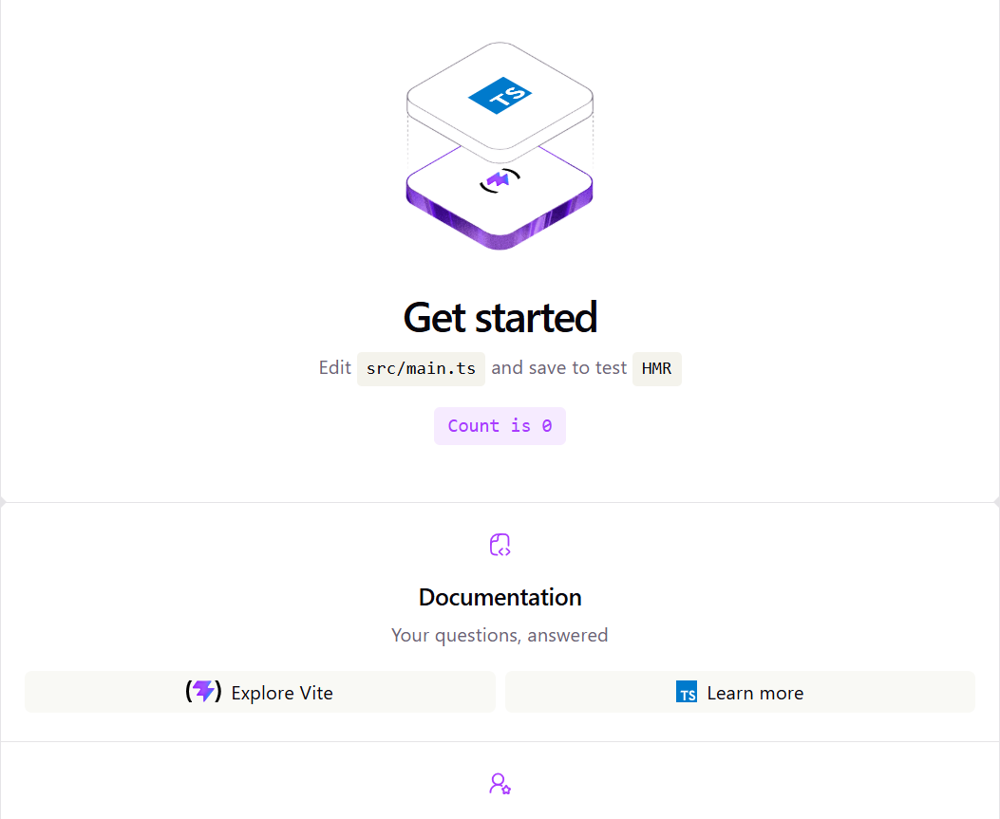
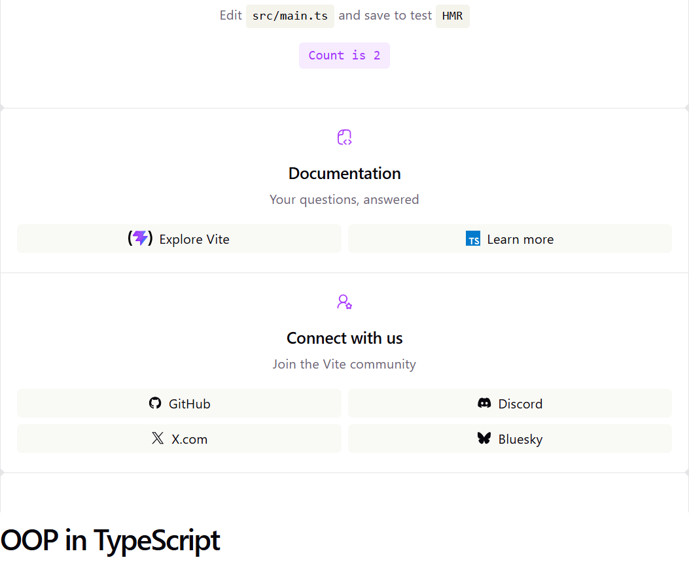

# OOP in TypeScript

A Vite page. The starter block fills `#app`, and the page heading sits under it.

## Description

From this folder, `npm run dev` starts it. This run was Vite 8.2.0 at http://localhost:5173/. The tab title is **oop-ts**.

`index.html` has an empty `#app` and a heading, "OOP in TypeScript". `src/main.ts` fills `#app` with the Vite starter: a hero, the heading "Get started", the line "Edit `src/main.ts` and save to test `HMR`", a counter button, then Documentation and Connect with us. The "OOP in TypeScript" heading sits under that block, aligned to the left.

The typeface is system-ui, Segoe UI, Roboto. The page background is white, `#fff`. Body text is `#6b6375`. Headings are `#08060d`. This window was 842px wide, so the rules at `max-width: 1024px` were on: body text 16px, headings 36px, section headings 20px. Documentation sits above Connect with us, and the links wrap two to a row. The counter text is `#aa3bff` on a pale purple button. This browser was using the light palette.

The button starts as "Count is 0". Each click adds 1. The first click reads "Count is 1". The second reads "Count is 2".

The Documentation links open in a new tab: [Explore Vite](https://vite.dev/) and [Learn more](https://www.typescriptlang.org/). Connect with us says "Join the Vite community" and links to [GitHub](https://github.com/vitejs/vite), [Discord](https://chat.vite.dev/), [X.com](https://x.com/vite_js), and [Bluesky](https://bsky.app/profile/vite.dev).

## Screenshots

### Start



### After two clicks



## Getting Started

### Dependencies

* Node.js and npm
* This run used Vite 8.2.0

### Installing

```bash
npm install
```

### Executing program

```bash
npm run dev
```

This run opened http://localhost:5173/.

## Help

The "OOP in TypeScript" heading is in `index.html` and sits under the block that `src/main.ts` writes into `#app`. The counter starts at 0 and adds 1 on each click.

## Authors

[Mamadou Moussa Balde](https://www.linkedin.com/in/2mb/)

## Version History

* Current local run
    * Vite 8.2.0 at http://localhost:5173/
    * Window width 842px, so the `max-width: 1024px` rules were on

## License

This folder does not include a `LICENSE.md` file.

## Acknowledgments

* [Vite](https://vite.dev/)
* [TypeScript](https://www.typescriptlang.org/)
* [README template](https://gist.github.com/DomPizzie/7a5ff55ffa9081f2de27c315f5018afc)
